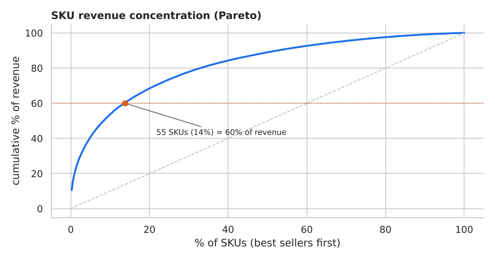
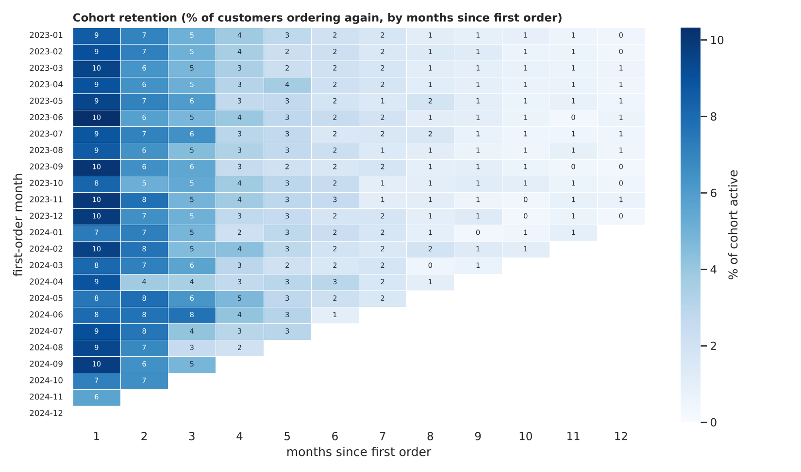

# E-Commerce Sales Performance Analysis

Exploratory and cohort analysis of 57,000+ order lines: clean a messy transactions export,
find the SKUs that drive revenue, measure customer drop-off after the first purchase, and turn the
findings into recommendations.

**Tools:** Python (pandas, NumPy, Matplotlib, Seaborn), Jupyter Notebook, Excel-ready outputs

> **Data note:** the dataset is **synthetic** (`src/generate_data.py`, seed 7) and deliberately
> messy. All figures below were produced by running `notebooks/ecommerce_sales_analysis.ipynb`
> on it; they describe this dataset, not a real retailer. The notebook runs unchanged on a real export
> with the same columns.



## Questions answered
1. Which SKUs drive most of the revenue?
2. How many customers drop off after their first purchase, and when do the rest come back?
3. Do acquisition channel, first category or discounts change repeat behaviour?
4. What should the business do about it?

## Data cleaning (57,263 raw lines -> 56,014 clean lines)
| Issue | Rows | Treatment |
|---|---|---|
| Exact duplicates | 684 | dropped (ignoring surrogate `line_id`) |
| Mixed date formats (`dd/mm/yyyy` vs ISO) | 339 | parsed both formats |
| Invalid quantity (<= 0) | 452 | removed |
| Quantity outliers (> 10; real orders are 1-4) | 113 | removed |
| Missing category | 672 | filled from the SKU's known category |
| Missing discount | 1,122 | inferred from `revenue = price x qty x (1 - discount)` |
| Missing country | 561 | filled from the customer's other orders |
| Missing payment method | 842 | labelled `Unknown` |

Revenue and customer metrics use **Delivered** lines only (90% of lines; 6.0% returned, 3.9% cancelled).

## Key findings
- **Revenue:** 2.72M across 31,957 orders and 22,948 customers; average order value 85.04.
- **Product concentration:** **55 SKUs (14% of the catalogue) generate 60% of revenue**; the top 20% of
  SKUs generate 68%. Electronics is 64% of the revenue in that top tier.
- **Drop-off:** among customers with at least 90 days of history, **80.7% do not place a second order
  within 90 days** (a fair window; the naive "one-time buyer" share is 76% but is biased by recent customers).
- **Value of repeat buyers:** customers with 2+ orders are 24% of customers but **45% of revenue**.
- **Timing:** half of returning customers reorder within **44 days**.
- **Segments barely differ:** 90-day repeat rate ranges only 18.7-20.1% by channel and 17.4-20.5% by
  first-order category, so drop-off is company-wide rather than a channel problem.



## Recommendations (details in the notebook)
1. Launch a post-purchase re-engagement flow around day 7 and day 30-45, and A/B test it against a holdout group.
2. Invest in the post-purchase experience rather than shifting budget between channels.
3. Protect availability, pricing and reviews for the ~55 SKUs that carry 60% of revenue.
4. Test next-purchase recommendations for first-time Books and Sports buyers (lowest repeat rates).
5. Don't count on first-order discounts for loyalty (+0.8 points, correlational).

## Repo layout
```
data/transactions_raw.csv                 generated raw data
src/generate_data.py                      synthetic data generator
notebooks/ecommerce_sales_analysis.ipynb  full analysis with outputs
images/                                   charts exported from the notebook
```

## How to run
```bash
pip install -r requirements.txt
python src/generate_data.py          # optional: regenerates data/transactions_raw.csv
jupyter notebook notebooks/ecommerce_sales_analysis.ipynb
```
